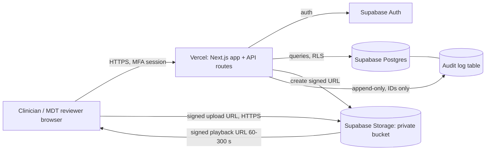
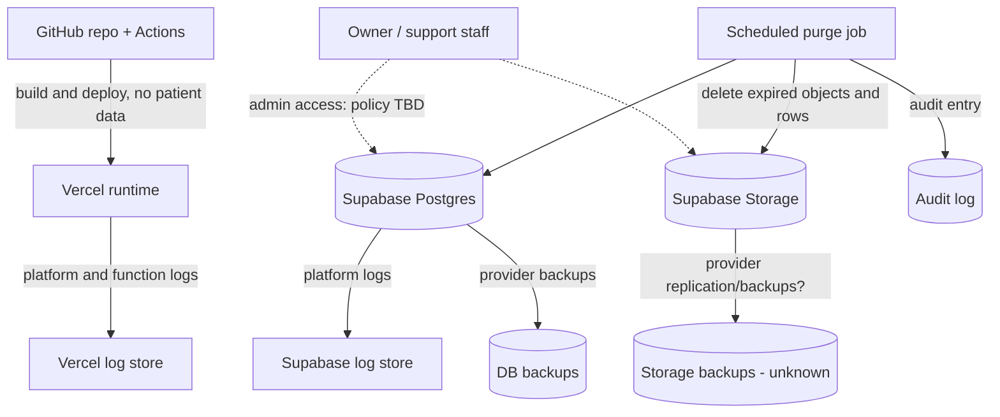
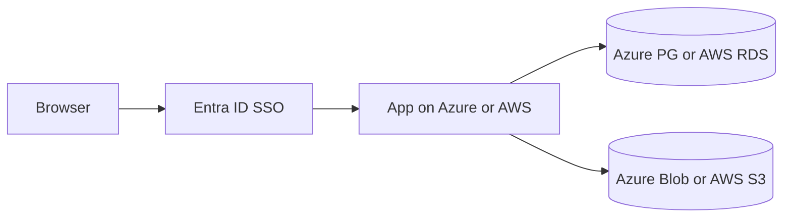

> **DRAFT — not reviewed by a qualified professional. Not evidence of compliance.**

Legend: **[Implemented]** built and verified · **[Planned]** designed/in progress · **[Assumption]** unconfirmed · **[External review]** needs qualified third party · **[NHS approval]** needs NHS organisation sign-off.

# 07 — Data Flow

**No claim of UK data residency is made.** The intended design is to use London-region resources where available; none has been verified. All flows are **[Planned]**; nothing is deployed. MVP uses synthetic data only.

## 1. Narrative

1. Clinician signs in (password plus MFA) through the app, which uses Supabase Auth.
2. Clinician selects a patient (data from Supabase Postgres via the Next.js server on Vercel; RLS plus app authorisation).
3. Identity-verification step: clinician confirms name and DOB/NHS number.
4. Browser records via getUserMedia/MediaRecorder; the blob lives in browser memory (local persistence cannot be ruled out).
5. App server issues a signed upload URL; browser uploads directly to private Supabase Storage. Server verifies object and writes metadata.
6. Playback: server authorises the user, issues a signed URL valid 60–300 s; browser streams video from Storage with persistent patient banner.
7. Every create/view/delete writes an append-only audit row (IDs only).
8. Retention job purges expired videos and metadata; deletion workflow audited.
9. Logs: Vercel and Supabase platform logs hold request metadata; the app must not log patient data.
10. Backups: provider-managed (details unknown).

## 2. Diagram A — request and media flow

## 3. Diagram B — supporting flows (logs, backups, CI, purge)

## 4. Diagram C — future state (not designed in detail)

## 5. Component and location table

| Component | Purpose | Data held | Region / location | Notes |
|---|---|---|---|---|
| Clinician device and browser | Capture, view | Video in memory; possible cache/temp files; session | Trust-controlled or other: Unknown — verify | Zero local persistence cannot be guaranteed |
| Vercel — serverless/runtime | Run Next.js app | Transient request data | Intended: UK (London) — UNVERIFIED. Function region selectable `<TBD>` | Verify per plan; Trust may require it |
| Vercel — edge / CDN | Serve static assets, routing | Static assets; request metadata | Unknown — verify | Likely global; ensure no patient data cached |
| Vercel — logs | Observability | Request metadata, IPs | Unknown — verify | No patient data to be logged |
| Supabase Postgres | Patients, metadata, audit | Identifiers, metadata | Intended: UK (London) — UNVERIFIED | Confirm project region at creation |
| Supabase Storage | Video files | Video | Intended: UK (London) — UNVERIFIED | Private bucket; confirm CDN/caching of objects |
| Supabase Auth | Identities, MFA | Staff emails, MFA secrets | Intended: UK (London) — UNVERIFIED | |
| Supabase logs | Observability | Metadata | Unknown — verify | |
| Backups (DB and storage) | Recovery | Copies of data | Unknown — verify | Retention vs deletion conflict (08) |
| Provider support access | Troubleshooting | Possibly any | Unknown — verify | Support staff location and access controls |
| GitHub (repo, Actions) | Source, CI/CD | Code, secrets (config) | Unknown — verify; typically US | No patient data; synthetic test data only |
| Email provider (auth emails) | Sign-in emails | Staff emails | Unknown — verify | `<TBD>` |
| Error/monitoring tool | None planned | n/a | n/a | Logs-only monitoring |
| Analytics | None | n/a | n/a | By design |
| DNS / domain / TLS | Resolution | None | Unknown — verify | |
| Future AWS (RDS+S3) / Azure (PG+Blob+Entra) | Possible later hosting | | UK South / eu-west-2 intended; not decided | |

## 6. Open actions

| # | Action | Who |
|---|---|---|
| 1 | Confirm Supabase project region and plan features (backups, PITR, support access) | Owner |
| 2 | Confirm Vercel function region, edge behaviour, log retention and DPA | Owner |
| 3 | Obtain subprocessor DPAs and transfer mechanisms | Lawyer / DPO **[External review]** |
| 4 | Verify no patient data in logs and cache headers on video responses | Owner (test) |
| 5 | Define who within PreVid can access production and how | Owner, 09 |
